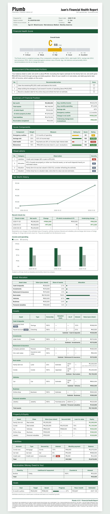

# Plumb

[](https://github.com/louiscada/plumb-skill/actions/workflows/tests.yml)
[](https://github.com/louiscada/plumb-skill/releases/latest)

A free Claude skill that gives your finances an honest check-up and a professional financial health report.

A plumb line shows what's truly level. Plumb does the same for your money: it takes one snapshot of your whole financial picture, grades it **A–F**, and gives you two or three concrete next steps, then runs a quick monthly or biweekly check-in and tracks your net worth over time. In chat it talks like a warm friend who happens to be good with money; on paper it hands you a report with your name on it.



## Quick start

**1. Download `plumb.zip`** from the [latest release](https://github.com/louiscada/plumb-skill/releases/latest) (under **Assets**). Don't unzip it.

**2. Install it:**

- **Claude app** (any plan, including Free):
  1. Turn on **Code execution and file creation** in **Settings → Capabilities**. Plumb needs it to do its math.
  2. Go to **Customize → Skills**, click **+**, choose **Create skill → Upload a skill**, and pick `plumb.zip`.
  3. On a Team or Enterprise plan, your admin may need to allow skills first.
- **Claude Code:** clone the repository and copy the `plumb` folder into your skills folder:

  ```bash
  git clone https://github.com/louiscada/plumb-skill.git
  cp -r plumb-skill/plumb ~/.claude/skills/
  ```

Linking the downloaded folder in a chat is not enough. Plumb has to be installed as a skill for Claude to use it. New versions are listed on the [Releases](https://github.com/louiscada/plumb-skill/releases) page; upload the newer `plumb.zip` the same way to update.

**Sharing Plumb with a friend?** Just send them `plumb.zip`. They don't need GitHub or any tech skills, only steps 2–4 here.

**3. Give it a home for your data.** In the Claude desktop app, link a folder such as `My Money` to your chat. Plumb keeps your numbers there in `plumb-data/ledger.json`, so it remembers you next time. In a chat with no folder, download `ledger.json` at the end and attach it next time.

**4. Say hi.** Start with:

> Rate my finances.

Plumb asks a few short rounds of questions (rough numbers are fine), grades you A–F and hands you your report. After that, just say **"money check-in"** every payday or month-end.

Plumb needs only Python 3, which Claude already has. There's nothing else to install.

## What it does

- **A complete balance sheet**, set up once in about six short rounds:
  - **Cash & deposits:** cash, savings, checking, time deposits, e-wallets, money market
  - **Investments:** stocks, bonds, funds, crypto, precious metals
  - **Retirement & insurance:** retirement accounts, pensions, insurance cash value
  - **Real estate:** land, homes, condos, rental and commercial property, including co-owned or family property by ownership share
  - **Vehicles, business stakes and personal valuables**
  - **Debts** of every kind, linked to the property they're secured by so you see your equity
  - **Money people owe you**, weighted by how likely it is to come back
  - Plus income, spending, lifestyle, risk tolerance, money personality and goals. Rough numbers are fine.
- **Little typing.** Choose quick (totals only), detailed, or screenshots of your bank or budget app. Questions with set answers come as tap-to-answer cards where your Claude app supports them, and a checklist up front means Plumb only asks about what you actually have.
- **An A–F grade** built from four parts: emergency cushion, debt health, savings rate and momentum. The grade is calculated by a script, so it's consistent and transparent, never vibes.
- **A professional report with your name on it** ("Juan's Financial Health Report") as a single HTML file, laid out like a bureau-style document: grade scale, summary of financial position, score components, observations, net worth history, asset allocation, assets grouped by class, property equity, liabilities, receivables, goals and recommended actions. It works offline and prints cleanly to PDF from any browser.
- **Quick check-ins** that only ask what changed since last time. Property and vehicle values carry forward; you refresh them about once a year.
- **Goal timelines.** Every goal shows your monthly pace and an estimated date ("₱1M around October 2029"), plus how much a deadline needs per month. Plumb can help you set targets you're unsure of, like a move-out fund.
- **What-if.** "What happens to my grade if I move out and pay ₱18k rent?" See the new cushion, savings rate and grade before you decide.
- **Income and spending chart** in the report, so spending creep is visible at a glance.
- **Fair to property owners and global investors.** A new appraisal of your land, or the peso moving against your US ETFs, changes your net worth but not your grade. The score tracks your underlying progress, not changes in estimates or exchange rates. Foreign holdings stay in their own currency.
- **Safe with your data.** A typo guard asks before recording a balance that jumps suspiciously, and the last 10 versions of your ledger are backed up automatically.
- **Lightweight on tokens.** Instructions load in layers, the math runs in a script, and check-ins read a compact summary instead of your whole history.

## Staying on schedule

A skill can't wake itself up, so set a recurring reminder for payday or the end of the month. If your Claude setup supports scheduled tasks, Plumb will offer to create one for you. Otherwise, a calendar reminder that says "money check-in" works fine.

## Your data

- Everything lives in one local file: `plumb-data/ledger.json` in your working folder. Nothing is sent to any server run by this project, and there is no such server.
- Your numbers are processed by whichever AI model you run the skill with, under that provider's privacy terms.
- Plumb asks for **account types, nicknames and balances only**. It never needs account numbers, card numbers, logins, PINs, bank names, or title, lot or plate numbers. The script refuses to save anything that looks like an account or card number.
- The `.gitignore` excludes `plumb-data/`, so forking this repo won't publish your finances. Keep it that way.
- If your platform doesn't keep files between conversations, download `ledger.json` after each check-in and attach it next time.

## How the grade works

| Part | Weight | Full marks |
|---|---|---|
| Emergency cushion (liquid savings ÷ monthly spending) | 30% | 6+ months |
| Debt health (payments ÷ income; penalty for 10%+ interest debt) | 30% | No debt, or low payments with nothing high-interest |
| Savings rate ((income − spending) ÷ income) | 25% | 30%+ |
| Momentum (net worth change excluding revaluations and exchange-rate moves, from the 2nd check-in) | 15% | Growing by half a month's spending per month |

**A** ≥ 85 · **B** ≥ 70 · **C** ≥ 55 · **D** ≥ 40 · **F** < 40. Details are in [`plumb/reference/rubric.md`](plumb/reference/rubric.md). The curves and thresholds sit at the top of [`plumb/scripts/plumb.py`](plumb/scripts/plumb.py) if you want to tune them.

## The script on its own

You can run the script without Claude:

```bash
python plumb/scripts/plumb.py init                 # create an empty ledger
python plumb/scripts/plumb.py checkin --json '{...}'
python plumb/scripts/plumb.py summary              # compact text
python plumb/scripts/plumb.py score                # grade, flags and goal timelines as JSON
python plumb/scripts/plumb.py whatif --json '{"spending_change": 18000}'   # compare a change
python plumb/scripts/plumb.py report --step "Pay extra on the card"   # HTML report
python plumb/scripts/plumb.py backups              # list automatic backups
python plumb/scripts/plumb.py restore --file <name>
```

## Not financial advice

Plumb is an educational check-up tool. It is not a licensed financial advisor and does not recommend specific stocks, funds, coins, banks, insurance or other products. Grades use common rules of thumb that won't fit everyone. Talk to a licensed professional before making investment, tax or insurance decisions.

## Contributing

Ideas and bug reports are welcome as [issues](https://github.com/louiscada/plumb-skill/issues/new/choose). Pull requests are reviewed by the maintainer, and only approved changes are merged into the official Plumb. Every change runs the automated tests, so a contribution can't silently change anyone's grade. See [CONTRIBUTING.md](CONTRIBUTING.md) and the [changelog](CHANGELOG.md).

## License

Plumb is free to use under the [Apache License 2.0](LICENSE). You can use it, adapt it for yourself and share it, as long as you keep the copyright and license notices (see [`NOTICE`](NOTICE)).

The license does not grant rights to the Plumb name or wordmark. If you publish a modified version, please give it a different name so people can tell it apart from the official Plumb.

The wordmark and report headings are set in [Francois One](https://fonts.google.com/specimen/Francois+One) by Vernon Adams, used under the SIL Open Font License 1.1. A Latin subset is bundled in `plumb/assets/` with its license ([`OFL-FrancoisOne.txt`](plumb/assets/OFL-FrancoisOne.txt)) and embedded in each report, so reports look the same offline and in print.
